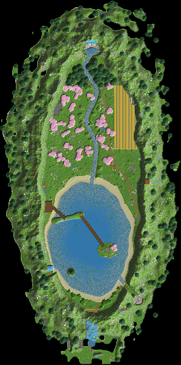

# 01 – Das versteckte Tal

**Rundum Felswände, rein kommt man nur durch einen Wasserfall.**

Von außen sieht man nur einen wilden Bergkamm mit Schneegipfeln. Der einzige Weg hinein führt durch einen Tunnel hinter einem Wasserfall.

Drinnen öffnet sich ein rund 180 × 470 Blöcke großes Tal mit Kirschwiese, Bach, Fichtenwald und einem großen See. Über den See spannt sich ein Felsbogen. Von den Wänden stürzen fünf Wasserfälle.

Die ganze Base steckt im Fels: Das Lager liegt hinter dem Hauptwasserfall, der Wohnbereich hat eine Glasfront zum See, die Farmen sind in der Ostwand versteckt.

## Eckdaten

| | |
|---|---|
| Größe (B × L × H) | 297 × 599 × 175 Blöcke |
| Sichtbare Blöcke | 537.730 (≈ 311 Shulker-Kisten) |
| Einfügehöhe | Unterkante der Schematic auf **Y 6** |
| Hinweis | Dann liegt der Boden rund um die Berge auf normaler Höhe (Y 63), und die Gipfel reichen bis Y 174. |

## Orte in der Landschaft

Positionen sind Koordinaten innerhalb der Schematic (X, Y, Z ab der unteren Ecke).

| Nr. | Ort | Art | Position | Beschreibung |
|---|---|---|---|---|
| 1 | Geheimer Eingang | Eingang | 150 / 60 / 557 | An der Außenwand stürzt ein 75 Blöcke hoher Wasserfall herab. Direkt dahinter beginnt ein 9 Blöcke breiter Tunnel. Er führt 34 Blöcke durch den Fels ins Tal und ist mit Laternen beleuchtet. |
| 2 | Shop-Platz | Shop | 123 / 57 / 563 | Ein kleiner Platz aus Steinziegeln vor dem Wasserfall mit Marktständen aus Fässern. Hier können Besucher handeln, ohne dass sie dein Tal sehen. |
| 3 | Lager hinter dem Wasserfall | Lager (im Fels) | 150 / 54 / 53 | Eine 36 × 25 Blöcke große Höhle hinter dem Hauptwasserfall im Norden. Man geht durch den Wasservorhang hinein. Drinnen stehen Regalreihen aus Fässern, Platz für ein Sortiersystem ist genug da. |
| 4 | Wohnbereich in der Felswand | Wohnen (im Fels) | 61 / 68 / 339 | Zwei Stockwerke sind in die Westwand gehauen, mit einer 23 Blöcke breiten Glasfront zum See. Davor liegt ein Balkon auf Stelzen, und eine Hängebrücke führt zum Felsbogen. |
| 5 | Werkstatt | Werkstatt (im Fels) | 88 / 57 / 176 | Eine gewölbte Kammer in der Westwand mit Werkbank, Schmiedetisch, Amboss und Schmelzöfen. Sie liegt nah am Lager. |
| 6 | Farm-Kammer 1 | Farm (im Fels) | 226 / 64 / 158 | 22 × 17 × 25 Blöcke im Fels der Ostwand. Gut geeignet für eine Eisenfarm. Von außen sieht man nur schmale Glasschlitze. |
| 7 | Farm-Kammer 2 | Farm (im Fels) | 236 / 64 / 190 | Gleiche Größe wie Kammer 1. Hier passen Tierfarmen hin, zum Beispiel Kühe, Schafe und Hühner. |
| 8 | Farm-Kammer 3 | Farm (im Fels) | 233 / 64 / 222 | Hier passt eine XP-Farm hin, zum Beispiel ein Mob-Spawner-Raum mit Wasserrinne. Sie liegt direkt hinter den Feldern. |
| 9 | Reisterrassen | Farm | 206 / 59 / 192 | Vier Terrassen mit Stützmauern aus bemoosten Steinziegeln. Wasserrinnen versorgen den Weizen. Zwei schmale Schleierfälle kommen von der Ostwand. |
| 10 | Felsbogen | Highlight | 109 / 76 / 358 | Ein natürlicher Steinbogen spannt sich 27 Blöcke hoch über den See. Oben wächst Gras. Hängebrücken verbinden ihn mit dem Wohnbereich und der Verzauberungsinsel. |
| 11 | Verzauberungsinsel | Werkstatt | 176 / 58 / 410 | Ein Ring aus Bücherregalen auf der Insel im See, mit einem Kirschbaum daneben. In die Mitte kommt der Zaubertisch. |
| 12 | Hauptwasserfall | Highlight | 150 / 95 / 69 | Er fällt aus einer Felsspalte 78 Blöcke tief in eine Gumpe. Von dort fließt ein Bach durch die Kirschwiese zum See. |
| 13 | Aussichtspunkt | Highlight | 241 / 153 / 298 | Eine Plattform auf dem höchsten Gipfel der Ostwand. Von hier sieht man das ganze Tal. |

## Bau-Reihenfolge

1. **Abstecken**: Den Umriss des Tals (Ellipse, ca. 180 × 470) und die Lage von Tunnel, See und Wasserfällen mit Wolle markieren.
2. **Wände hochziehen**: Den Bergring rundum aufbauen, außen flacher und innen steil mit kleinen Simsen. Hier werden die meisten Blöcke verbaut.
3. **Tal ausheben**: See (bis 14 tief), Bachbett und Gumpe ausgraben. Was dabei abgebaut wird, geht direkt in die Wände.
4. **Wasser**: Quellen in die Felsspalten setzen. Fallendes Wasser fließt nicht seitlich, deshalb bleibt der Höhleneingang hinter dem Vorhang frei.
5. **Base einbauen**: Lager, Werkstatt, Wohnbereich und Farm-Kammern in den Fels hauen und dann Fensterfronten und Balkon bauen.
6. **Natur**: Bäume, Büsche, Terrassen, Wege mit Laternen. Zuletzt Schnee auf die Gipfel.

## Tipps

- Die Wände mit 3–4 Gesteinsarten in Schichten bauen (Stein, Andesit, Tuff, Calcit). Dann sehen sie aus wie echte Felsen.
- Damit Laub nicht zerfällt, entweder mit Schere abgebautes Laub benutzen oder es nah an Stämmen platzieren. In der Schematic ist es als dauerhaft markiert.
- Den Tunnel-Eingang erst ganz zum Schluss öffnen. So bleibt das Tal bis zur Enthüllung geheim.

## Materialliste (sichtbare Blöcke)

Gezählt sind nur Blöcke, die man sieht. Das Innere von Bergen und Inseln kann aus beliebigem Material sein.

| Block | Anzahl | Stacks | Shulker |
|---|---:|---:|---:|
| Andesit | 151.014 | 2.360 | 87.4 |
| Stein | 136.930 | 2.140 | 79.2 |
| Grasblock | 58.758 | 919 | 34.0 |
| Fichtennadeln | 45.206 | 707 | 26.2 |
| Moosblock | 34.887 | 546 | 20.2 |
| Tuffstein | 31.463 | 492 | 18.2 |
| Sand | 13.488 | 211 | 7.8 |
| Erde | 13.146 | 206 | 7.6 |
| Bemooster Bruchstein | 8.533 | 134 | 4.9 |
| Kies | 7.183 | 113 | 4.2 |
| Kirschblätter | 5.917 | 93 | 3.4 |
| Bruchstein | 4.212 | 66 | 2.4 |
| Ton | 4.010 | 63 | 2.3 |
| Weizen | 2.950 | 47 | 1.7 |
| Ackerboden | 2.949 | 47 | 1.7 |
| Steinziegel | 2.699 | 43 | 1.6 |
| Fichtenholzbretter | 2.605 | 41 | 1.5 |
| Grobe Erde | 1.876 | 30 | 1.1 |
| Azaleenlaub | 1.601 | 26 | 0.9 |
| Trampelpfad | 1.255 | 20 | 0.7 |
| Fichtenstamm | 1.117 | 18 | 0.6 |
| Birkenlaub | 1.031 | 17 | 0.6 |
| Blühendes Azaleenlaub | 694 | 11 | 0.4 |
| Eichenlaub | 681 | 11 | 0.4 |
| Kirschstamm | 680 | 11 | 0.4 |
| Fass | 622 | 10 | 0.4 |
| Bemooste Steinziegel | 546 | 9 | 0.3 |
| Glas | 545 | 9 | 0.3 |
| Fichtenholzzaun | 336 | 6 | 0.2 |
| Birkenstamm | 242 | 4 | 0.1 |
| Eichenstamm | 174 | 3 | 0.1 |
| Bücherregal | 173 | 3 | 0.1 |
| Laterne | 146 | 3 | 0.1 |
| Polierter Andesit | 49 | 1 | 0.0 |
| Entrindeter Fichtenstamm | 6 | 1 | 0.0 |
| Schmelzofen | 2 | 1 | 0.0 |
| Schneeblock | 1 | 1 | 0.0 |
| Werkbank | 1 | 1 | 0.0 |
| Schmiedetisch | 1 | 1 | 0.0 |
| Amboss | 1 | 1 | 0.0 |

## Dateien

- `verstecktes-tal.litematic`: für die Mod **Litematica**. Die Landschaft erscheint als Geisterblöcke in der Welt, und du baust sie Block für Block nach.
- `verstecktes-tal.schem`: für **WorldEdit**. Mit `//paste -a` einfügen, damit Luft nichts überschreibt.
- `draufsicht.png`: Draufsicht als Bild.

Die 3D-Ansicht mit allen Orten gibt es im Viewer (`../../viewer/index.html`).
