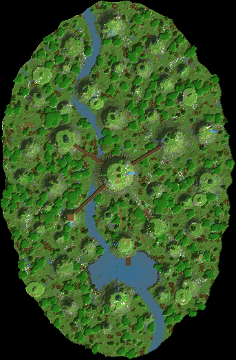

# 02 – Die Felsnadeln

**45 Felstürme ragen aus dem Urwald, verbunden durch Hängebrücken.**

Ein dichter Urwald mit Fluss und See. Daraus ragen 45 Felsnadeln bis zu 188 Blöcke hoch auf. Oben wachsen Bäume, an den Seiten hängen Lianen, und von manchen stürzen Wasserfälle.

Die Base verteilt sich auf fünf Türme: Im Hauptturm liegen vier runde Hallen übereinander. Ein gläserner Wasser-Aufzug verbindet sie. Hängebrücken führen zum Lagerturm, Farmturm, Werkstattturm und Aussichtsturm.

Zwischen den Nadeln schweben Felsbrocken. Ein natürlicher Felsbogen, die Himmelsbrücke, verbindet zwei Türme.

## Eckdaten

| | |
|---|---|
| Größe (B × L × H) | 343 × 522 × 232 Blöcke |
| Sichtbare Blöcke | 630.156 (≈ 364 Shulker-Kisten) |
| Einfügehöhe | Unterkante der Schematic auf **Y 33** |
| Hinweis | Dann liegt der Waldboden auf Y 63, und die höchste Nadel reicht bis Y 260. |

## Orte in der Landschaft

Positionen sind Koordinaten innerhalb der Schematic (X, Y, Z ab der unteren Ecke).

| Nr. | Ort | Art | Position | Beschreibung |
|---|---|---|---|---|
| 1 | Tor am Fuß des Hauptturms | Eingang | 170 / 33 / 255 | Ein 5 Blöcke breites Tor führt in den Fels. Von hier geht es mit dem Wasser-Aufzug nach oben, oder außen über die Wendeltreppe. |
| 2 | Wendeltreppe | Highlight | 196 / 48 / 251 | Eine 4 Blöcke breite Holztreppe windet sich 1,6-mal um den Hauptturm, vom Waldboden bis zur Eingangshalle 30 Blöcke darüber. Alle paar Meter hängt eine Laterne. |
| 3 | Eingangshalle | Wohnen (im Fels) | 170 / 58 / 251 | Die erste runde Halle im Hauptturm hat sechs Panoramafenster. Durch die Mitte läuft der gläserne Wasser-Aufzug. Eine Hängebrücke führt zum Farmturm. |
| 4 | Wohnbereich | Wohnen (im Fels) | 170 / 90 / 251 | Die zweite Halle liegt 62 Blöcke über dem Boden. Von hier gehen Brücken zum Lagerturm und zum Aussichtsturm. |
| 5 | Schlafzimmer | Wohnen (im Fels) | 170 / 122 / 251 | Die dritte Halle mit Blick über den Urwald. Eine Brücke führt zur Werkstatt. |
| 6 | Bibliothek | Werkstatt (im Fels) | 170 / 154 / 251 | Die oberste Halle mit Bücherregalen in der Mitte. Gut geeignet zum Verzaubern. Darüber liegt der Gipfelgarten. |
| 7 | Lagerturm | Lager (im Fels) | 94 / 91 / 201 | Eine runde Halle 62 Blöcke über dem Boden mit Regalreihen aus Fässern. Sie ist per Hängebrücke mit dem Wohnbereich verbunden. |
| 8 | Farmturm | Farm (im Fels) | 248 / 75 / 203 | Drei übereinanderliegende Farm-Etagen (je 11 hoch), zum Beispiel für Eisen, Tiere und Mobs. Die Brücke kommt in der mittleren Etage an. |
| 9 | Werkstatt | Werkstatt (im Fels) | 226 / 128 / 327 | Die Werkstatt liegt direkt unter dem Gipfel des Werkstattturms. Daneben spannt sich die Himmelsbrücke, ein natürlicher Felsbogen. |
| 10 | Aussichtsturm | Highlight | 102 / 217 / 315 | Die dünnste und höchste Nadel: 187 Blöcke über dem Wald. Oben ist eine Plattform mit Laternen. |
| 11 | Bootssteg und Shop | Shop | 186 / 31 / 355 | Ein Marktplatz aus Holz am See mit einem Steg. Besucher kommen mit dem Boot über den Fluss. |
| 12 | Schwebende Felsen | Highlight | 275 / 178 / 139 | Sechs Felsbrocken schweben zwischen den Nadeln, mit Bäumen oben und Wurzeln unten. |

## Bau-Reihenfolge

1. **Grundriss**: Positionen der Nadeln mit Wollsäulen markieren. Zuerst die fünf Base-Türme, dann die Deko-Nadeln dazwischen.
2. **Hauptturm hochziehen**: Den Hauptturm als Hülle bauen (außen Fels, innen hohl). Die vier Hallen gleich beim Hochbauen aussparen. Das spart Hunderttausende Blöcke.
3. **Aufzug und Treppe**: Seelensand unten, Wassersäule bis oben, Glas drumherum. Danach außen die Wendeltreppe anbringen.
4. **Weitere Türme**: Lager-, Farm-, Werkstatt- und Aussichtsturm bauen und mit Hängebrücken verbinden.
5. **Deko-Nadeln**: Die übrigen Nadeln nach und nach hinzufügen. Hier reicht eine Hülle von 2 Blöcken Dicke.
6. **Urwald und Wasser**: Fluss, See, Wasserfälle und zuletzt der Urwald mit Lianen.

## Tipps

- Die Nadeln mit senkrechten Streifen aus Stein, Andesit und Tuff bauen und Moosflecken einstreuen. So sehen sie aus wie echter, verwitterter Fels.
- Hohl bauen: Eine 2–3 Blöcke dicke Hülle sieht von außen genauso aus und braucht nur einen Bruchteil der Blöcke.
- Für den Wasser-Aufzug unten Seelensand setzen (nach oben) oder Magmablock (nach unten).

## Materialliste (sichtbare Blöcke)

Gezählt sind nur Blöcke, die man sieht. Das Innere von Bergen und Inseln kann aus beliebigem Material sein.

| Block | Anzahl | Stacks | Shulker |
|---|---:|---:|---:|
| Stein | 140.677 | 2.199 | 81.4 |
| Andesit | 138.378 | 2.163 | 80.1 |
| Grasblock | 88.001 | 1.376 | 50.9 |
| Tropenbaumlaub | 65.872 | 1.030 | 38.1 |
| Tuffstein | 50.392 | 788 | 29.2 |
| Moosblock | 49.979 | 781 | 28.9 |
| Tropenbaumstamm | 18.546 | 290 | 10.7 |
| Azaleenlaub | 12.659 | 198 | 7.3 |
| Schwarzeichenlaub | 11.123 | 174 | 6.4 |
| Erde | 10.858 | 170 | 6.3 |
| Kies | 8.305 | 130 | 4.8 |
| Podsol | 8.096 | 127 | 4.7 |
| Bemooster Bruchstein | 8.021 | 126 | 4.6 |
| Fichtenholzbretter | 5.534 | 87 | 3.2 |
| Blühendes Azaleenlaub | 3.568 | 56 | 2.1 |
| Fichtennadeln | 2.288 | 36 | 1.3 |
| Schwarzeichenstamm | 2.029 | 32 | 1.2 |
| Steinziegel | 1.694 | 27 | 1.0 |
| Glas | 1.551 | 25 | 0.9 |
| Fichtenholzzaun | 650 | 11 | 0.4 |
| Schlamm | 436 | 7 | 0.3 |
| Granit | 385 | 7 | 0.2 |
| Bücherregal | 280 | 5 | 0.2 |
| Trampelpfad | 217 | 4 | 0.1 |
| Mangrovenwurzeln | 145 | 3 | 0.1 |
| Hängende Wurzeln | 136 | 3 | 0.1 |
| Laterne | 135 | 3 | 0.1 |
| Fass | 106 | 2 | 0.1 |
| Fichtenstamm | 89 | 2 | 0.1 |
| Schmelzofen | 2 | 1 | 0.0 |
| Werkbank | 1 | 1 | 0.0 |
| Schmiedetisch | 1 | 1 | 0.0 |
| Amboss | 1 | 1 | 0.0 |
| Seelensand | 1 | 1 | 0.0 |

## Dateien

- `felsnadeln.litematic`: für die Mod **Litematica**. Die Landschaft erscheint als Geisterblöcke in der Welt, und du baust sie Block für Block nach.
- `felsnadeln.schem`: für **WorldEdit**. Mit `//paste -a` einfügen, damit Luft nichts überschreibt.
- `draufsicht.png`: Draufsicht als Bild.

Die 3D-Ansicht mit allen Orten gibt es im Viewer (`../../viewer/index.html`).
