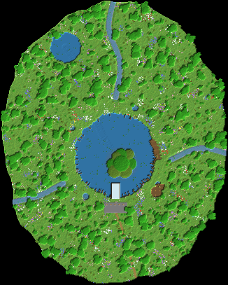

# 03 – Die Riesen-Doline

**Ein riesiges Loch im Dschungel. Unten liegt eine eigene Welt.**

Von weitem sieht man nur Dschungel. Dann öffnet sich der Boden: Ein 120 Blöcke breites Loch fällt 78 Blöcke tief ab. Darunter weitet es sich wie eine Glocke auf über 160 Blöcke.

Unten liegt ein türkiser See mit einer Insel, auf der ein Urwaldriese dem Licht entgegenwächst. Lianen und Wurzeln hängen von der Decke, drei Wasserfälle stürzen hinab.

Die Base hängt an der Wand: Ein Spiralweg führt hinunter. Von ihm gehen Wohnbereich, Werkstatt, Lager und Farmen ab, und ganz unten liegt ein Raum mit Glaswand unter Wasser.

## Eckdaten

| | |
|---|---|
| Größe (B × L × H) | 326 × 407 × 139 Blöcke |
| Sichtbare Blöcke | 474.751 (≈ 274 Shulker-Kisten) |
| Einfügehöhe | Unterkante der Schematic auf **Y -41** |
| Hinweis | Dann liegt das Plateau auf Y 63 und der See unten auf Y -15. |

## Orte in der Landschaft

Positionen sind Koordinaten innerhalb der Schematic (X, Y, Z ab der unteren Ecke).

| Nr. | Ort | Art | Position | Beschreibung |
|---|---|---|---|---|
| 1 | Einstieg zum Spiralweg | Eingang | 216 / 105 / 199 | Am Rand des Lochs beginnt ein 6 Blöcke breiter Holzweg. Er schraubt sich in 1,35 Runden an der Wand entlang 78 Blöcke tief bis zum See. Laternen hängen an Ketten über dem Abgrund. |
| 2 | Glasboden-Plattform | Highlight | 165 / 105 / 271 | Eine Plattform mit Glasboden ragt 20 Blöcke weit über den Abgrund. Darunter geht es fast 80 Blöcke in die Tiefe. |
| 3 | Shop am Rand | Shop | 165 / 106 / 296 | Ein Marktplatz aus Steinziegeln direkt hinter der Plattform. Besucher sehen das Loch, kommen aber nicht hinein. |
| 4 | Wohnbereich | Wohnen (im Fels) | 223 / 95 / 273 | Ein großer Raum in der Wand, kurz unter dem Rand, mit einem Holzbalkon über dem Abgrund. |
| 5 | Werkstatt | Werkstatt (im Fels) | 102 / 77 / 249 | Eine Kammer auf halber Höhe des Spiralwegs, mit Steinboden für Amboss und Schmelzöfen. |
| 6 | Lagerhalle | Lager (im Fels) | 144 / 61 / 127 | Die größte Kammer (26 × 26, 10 hoch) liegt tief im Fels. Hier ist viel Platz für ein Sortiersystem. |
| 7 | Farm-Stollen | Farm (im Fels) | 263 / 46 / 212 | Eine 14 Blöcke hohe Halle kurz über dem See. Hier passen Eisen- und Mobfarmen hin, die man von oben nicht sieht. |
| 8 | Unterwasser-Raum | Wohnen (im Fels) | 165 / 14 / 221 | Er liegt 12 Blöcke unter dem Seespiegel. Durch die Glaswand sieht man in den türkisen See. Eine Treppe führt vom Ende des Spiralwegs hinunter. |
| 9 | Insel mit Riesenbaum | Highlight | 173 / 30 / 233 | Ein 50 Blöcke hoher Urwaldriese wächst aus der Insel in der Seemitte dem Licht entgegen. |
| 10 | Kleine Doline und Höhlenfluss | Highlight | 93 / 28 / 67 | Ein zweites, kleineres Loch im Norden. Ein unterirdischer Fluss verbindet es mit dem großen See. Mit dem Boot kann man hindurchfahren. |
| 11 | Wasserfälle | Highlight | 165 / 84 / 159 | Drei Bäche stürzen über den Rand frei bis in den See, fast 80 Blöcke tief. |

## Bau-Reihenfolge

1. **Umriss markieren**: Den oberen Rand des Lochs (ca. 120 Blöcke Durchmesser) auf dem Boden abstecken, ebenso die kleine Doline im Norden.
2. **Ausheben**: Das Loch Schicht für Schicht ausgraben und dabei die Glockenform beachten: unten breiter als oben. Das sind Millionen Blöcke, also mit Spitzhacke Effizienz V, Eile und Beacon arbeiten.
3. **See und Insel**: Den Boden als Schüssel formen, mit Wasser füllen und die Insel aufschütten.
4. **Spiralweg**: Den Weg von oben nach unten an der Wand entlang bauen. Er dient gleichzeitig als Gerüst für alles Weitere.
5. **Räume**: Wohnbereich, Werkstatt, Lager, Farm-Stollen und Unterwasser-Raum vom Weg aus in den Fels graben.
6. **Leben**: Riesenbaum, Lianen, Wurzeln, Tropfsteine, Wasserfälle und die Glasplattform.

## Tipps

- Beim Ausheben fällt extrem viel Stein an. Damit kannst du die Farmen und den Rand des Plateaus bauen.
- Damit der See türkis aussieht, die Doline in ein warmes Biom bauen (Dschungel oder warmer Ozean). Die Wasserfarbe hängt vom Biom ab.
- Glasboden über dem Abgrund: Mit getöntem Glas darunter wirkt es noch tiefer.

## Materialliste (sichtbare Blöcke)

Gezählt sind nur Blöcke, die man sieht. Das Innere von Bergen und Inseln kann aus beliebigem Material sein.

| Block | Anzahl | Stacks | Shulker |
|---|---:|---:|---:|
| Stein | 104.646 | 1.636 | 60.6 |
| Grasblock | 80.306 | 1.255 | 46.5 |
| Tropenbaumlaub | 63.784 | 997 | 36.9 |
| Andesit | 52.071 | 814 | 30.1 |
| Diorit | 37.771 | 591 | 21.9 |
| Calcit | 24.715 | 387 | 14.3 |
| Moosblock | 21.153 | 331 | 12.2 |
| Tropenbaumstamm | 16.072 | 252 | 9.3 |
| Tuffstein | 14.203 | 222 | 8.2 |
| Azaleenlaub | 9.559 | 150 | 5.5 |
| Bemooster Bruchstein | 9.062 | 142 | 5.2 |
| Sand | 7.048 | 111 | 4.1 |
| Fichtenholzbretter | 6.051 | 95 | 3.5 |
| Erde | 6.003 | 94 | 3.5 |
| Bruchstein | 4.984 | 78 | 2.9 |
| Ton | 4.853 | 76 | 2.8 |
| Tropfsteinblock | 4.719 | 74 | 2.7 |
| Kies | 2.483 | 39 | 1.4 |
| Steinziegel | 1.842 | 29 | 1.1 |
| Fichtenholzzaun | 801 | 13 | 0.5 |
| Podsol | 654 | 11 | 0.4 |
| Höhlenranken mit Leuchtbeeren | 523 | 9 | 0.3 |
| Hängende Wurzeln | 514 | 9 | 0.3 |
| Kette | 267 | 5 | 0.2 |
| Glas | 242 | 4 | 0.1 |
| Trampelpfad | 192 | 3 | 0.1 |
| Blühendes Azaleenlaub | 125 | 2 | 0.1 |
| Laterne | 93 | 2 | 0.1 |
| Fass | 15 | 1 | 0.0 |

## Dateien

- `riesen-doline.litematic`: für die Mod **Litematica**. Die Landschaft erscheint als Geisterblöcke in der Welt, und du baust sie Block für Block nach.
- `riesen-doline.schem`: für **WorldEdit**. Mit `//paste -a` einfügen, damit Luft nichts überschreibt.
- `draufsicht.png`: Draufsicht als Bild.

Die 3D-Ansicht mit allen Orten gibt es im Viewer (`../../viewer/index.html`).
