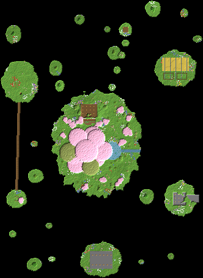

# 04 – Die schwebenden Inseln

**Über 20 Inseln im Himmel. In der Mitte steht ein riesiger Kirschbaum.**

Hoch über dem Boden schweben über 20 Inseln. Die Hauptinsel ist 145 × 170 Blöcke groß, die kleinsten sind nur ein paar Blöcke breit.

Auf der Hauptinsel wächst ein riesiger Kirschbaum. Seine Wurzeln hängen unten aus dem Fels. Ein See läuft über die Kante und stürzt als Wasserfall in die Tiefe.

Jede große Insel hat eine Aufgabe: Wohnen, Farmen, Lager, Werkstatt, Shop, Verzaubern. Hängebrücken verbinden sie, Ketten und Lianen hängen unter ihnen.

## Eckdaten

| | |
|---|---|
| Größe (B × L × H) | 332 × 454 × 227 Blöcke |
| Sichtbare Blöcke | 186.862 (≈ 108 Shulker-Kisten) |
| Einfügehöhe | Unterkante der Schematic auf **Y 90** |
| Hinweis | Dann schweben die Inseln hoch über dem Boden (Y 63). Den Blasen-Aufzug bis zum Boden verlängern. |

## Orte in der Landschaft

Positionen sind Koordinaten innerhalb der Schematic (X, Y, Z ab der unteren Ecke).

| Nr. | Ort | Art | Position | Beschreibung |
|---|---|---|---|---|
| 1 | Blasen-Aufzug | Eingang | 187 / 4 / 424 | Ein gläserner Wasser-Aufzug mit Seelensand am Boden bringt dich in Sekunden vom Erdboden zur Shopinsel. Mit Elytren landest du auch direkt auf dem Marktplatz. |
| 2 | Shopinsel | Shop | 165 / 126 / 424 | Ein Marktplatz aus Steinziegeln mit acht Ständen. Er ist die Ankunftsinsel für Besucher und über eine Hängebrücke mit der Hauptinsel verbunden. |
| 3 | Weltenbaum | Highlight | 141 / 181 / 246 | Ein 58 Blöcke hoher Kirschbaum mit über 50 Blöcke breiter Krone. Seine Wurzeln wachsen durch die Insel und hängen unten frei in der Luft. |
| 4 | Wohnbereich im Hügel | Wohnen (im Fels) | 145 / 160 / 182 | Eine gewölbte Halle im Hügel der Hauptinsel. Die Glasfront schaut direkt auf den Weltenbaum und den See. |
| 5 | See mit Wasserfall ins Leere | Highlight | 183 / 152 / 246 | Ein kleiner See auf der Hauptinsel. Sein Abfluss stürzt über die Inselkante in die Tiefe. |
| 6 | Farminsel | Farm | 287 / 139 / 112 | Weizenfelder mit Wasserrinnen und zwei eingezäunte Weiden für Tiere. |
| 7 | Lagerinsel | Lager (im Fels) | 33 / 145 / 134 | Die ganze Insel ist innen hohl. In der 32 × 36 Blöcke großen Halle stehen Regalreihen aus Fässern. Eine Treppe führt von oben hinein. |
| 8 | Werkstatt unter dem Überhang | Werkstatt (im Fels) | 293 / 161 / 324 | In die Werkstattinsel gehauen, mit einer offenen Terrasse. Darunter geht es 187 Blöcke tief bis zum Boden. |
| 9 | Verzauberungsinsel | Werkstatt | 27 / 187 / 324 | Die zweithöchste Insel, mit einem Ring aus Bücherregalen und einem Kirschbaum. Eine Brücke führt zur Lagerinsel. |
| 10 | Sprungpfad und Aussichtsinsel | Highlight | 205 / 208 / 48 | Vier Mini-Inseln bilden einen Sprungpfad hinauf zur höchsten Insel. Oben ist eine Plattform mit Laternen. |

## Bau-Reihenfolge

1. **Gerüst**: Die Mittelpunkte der Inseln mit Säulen aus Gerüst oder Wolle in der richtigen Höhe markieren.
2. **Hauptinsel**: Zuerst die flache Oberseite bauen, dann die kegelförmige Unterseite Schicht für Schicht nach unten. So hat man immer eine Fläche zum Stehen.
3. **Weltenbaum**: Stamm, Äste und Krone, dann die Wurzeln, die durch die Insel nach unten wachsen.
4. **Weitere Inseln**: Shop-, Farm-, Lager-, Werkstatt- und Verzauberungsinsel bauen und mit Brücken verbinden.
5. **Aufzug**: Den Blasen-Aufzug vom Boden bis zur Shopinsel bauen: Seelensand unten, Wassersäule, Glas außen herum.
6. **Details**: Deko-Inseln, Ketten, Lianen, Wasserfälle und Gerüst wieder abbauen.

## Tipps

- Die Schematic so einfügen, dass ihre Unterkante auf Y 90 liegt. Die höchste Insel reicht dann bis Y 310. Den Aufzug unten bis zum Boden verlängern.
- Der Wasserfall fällt in Minecraft bis zum Boden. Unten ein Becken bauen, sonst fließt das Wasser breit auseinander.
- Unterseiten aus Stein, Andesit und Tuff in Schichten bauen. Hängende Wurzeln und Ketten verstärken den Schwebe-Effekt.

## Materialliste (sichtbare Blöcke)

Gezählt sind nur Blöcke, die man sieht. Das Innere von Bergen und Inseln kann aus beliebigem Material sein.

| Block | Anzahl | Stacks | Shulker |
|---|---:|---:|---:|
| Stein | 34.357 | 537 | 19.9 |
| Grasblock | 32.954 | 515 | 19.1 |
| Kirschblätter | 30.326 | 474 | 17.5 |
| Andesit | 16.325 | 256 | 9.4 |
| Tuffstein | 16.264 | 255 | 9.4 |
| Granit | 12.877 | 202 | 7.5 |
| Erde | 8.480 | 133 | 4.9 |
| Moosblock | 7.245 | 114 | 4.2 |
| Blühendes Azaleenlaub | 6.066 | 95 | 3.5 |
| Bemooster Bruchstein | 3.151 | 50 | 1.8 |
| Hängende Wurzeln | 3.005 | 47 | 1.7 |
| Fichtenholzbretter | 2.537 | 40 | 1.5 |
| Kirschstamm | 2.377 | 38 | 1.4 |
| Steinziegel | 1.757 | 28 | 1.0 |
| Azaleenlaub | 1.689 | 27 | 1.0 |
| Mangrovenwurzeln | 1.615 | 26 | 0.9 |
| Ackerboden | 858 | 14 | 0.5 |
| Weizen | 858 | 14 | 0.5 |
| Fass | 787 | 13 | 0.5 |
| Sand | 708 | 12 | 0.4 |
| Glas | 662 | 11 | 0.4 |
| Birkenlaub | 400 | 7 | 0.2 |
| Fichtenholzzaun | 396 | 7 | 0.2 |
| Kette | 349 | 6 | 0.2 |
| Eichenlaub | 267 | 5 | 0.2 |
| Kies | 158 | 3 | 0.1 |
| Bücherregal | 114 | 2 | 0.1 |
| Eichenstamm | 92 | 2 | 0.1 |
| Laterne | 85 | 2 | 0.0 |
| Birkenstamm | 77 | 2 | 0.0 |
| Entrindeter Fichtenstamm | 18 | 1 | 0.0 |
| Heuballen | 2 | 1 | 0.0 |
| Schmelzofen | 2 | 1 | 0.0 |
| Werkbank | 1 | 1 | 0.0 |
| Schmiedetisch | 1 | 1 | 0.0 |
| Amboss | 1 | 1 | 0.0 |
| Seelensand | 1 | 1 | 0.0 |

## Dateien

- `schwebende-inseln.litematic`: für die Mod **Litematica**. Die Landschaft erscheint als Geisterblöcke in der Welt, und du baust sie Block für Block nach.
- `schwebende-inseln.schem`: für **WorldEdit**. Mit `//paste -a` einfügen, damit Luft nichts überschreibt.
- `draufsicht.png`: Draufsicht als Bild.

Die 3D-Ansicht mit allen Orten gibt es im Viewer (`../../viewer/index.html`).
