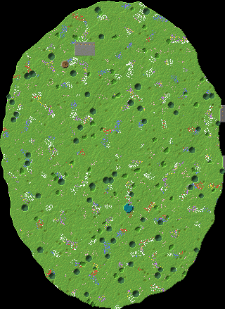

# 05 – Die leuchtende Unterwelt

**Oben eine normale Wiese, darunter eine riesige leuchtende Höhle.**

Von oben sieht alles normal aus: Wiese, ein paar Bäume, ein bemooster Steinring. Darin führt eine Wendeltreppe 90 Blöcke tief in eine Höhle von 280 × 390 Blöcken, die bis zu 75 Blöcke hoch ist.

Unten leuchtet alles: Riesenpilze mit Pilzlicht, Hunderte Leuchtbeeren-Ranken, Froschlichter in der Decke, Tropfsteinsäulen und ein unterirdischer See. Ein Lichtschacht lässt Tageslicht auf die Insel fallen.

Die Base ist in die Höhlenwände gebaut, dazu kommen eine Werkstatt im Pilzhut und eine Amethyst-Geode als Verzauberungsraum.

## Eckdaten

| | |
|---|---|
| Größe (B × L × H) | 320 × 439 × 130 Blöcke |
| Sichtbare Blöcke | 595.442 (≈ 344 Shulker-Kisten) |
| Einfügehöhe | Unterkante der Schematic auf **Y -49** |
| Hinweis | Dann liegt die Wiese auf Y 63, und der Höhlensee liegt auf Y -29. |

## Orte in der Landschaft

Positionen sind Koordinaten innerhalb der Schematic (X, Y, Z ab der unteren Ecke).

| Nr. | Ort | Art | Position | Beschreibung |
|---|---|---|---|---|
| 1 | Wendelschacht (Eingang) | Eingang | 92 / 113 / 91 | Auf der Wiese liegt nur ein bemooster Steinring. Darin führt eine Wendeltreppe 90 Blöcke in die Tiefe, dann geht ein Gang mit Laternen in die Höhle. |
| 2 | Shop an der Oberfläche | Shop | 120 / 112 / 69 | Ein kleiner Marktplatz neben dem Schacht. Besucher handeln hier oben und ahnen nicht, was darunter liegt. |
| 3 | Lichtschacht und Pilzinsel | Highlight | 182 / 24 / 295 | Ein 13 Blöcke breiter Schacht lässt Tageslicht auf die Insel im See fallen. Darauf steht ein türkiser Riesenpilz mit grünen Froschlichtern. |
| 4 | Wohnbereich mit Höhlenbalkon | Wohnen (im Fels) | 160 / 47 / 42 | Zwei Stockwerke in der Nordwand mit Glasfront und einem Balkon auf Stelzen. Man blickt über die ganze leuchtende Höhle. |
| 5 | Lager | Lager (im Fels) | 33 / 18 / 229 | Eine gewölbte Halle (27 × 32) in der Westwand mit zehn Regalreihen aus Fässern. |
| 6 | Farm-Höhlen | Farm (im Fels) | 278 / 27 / 197 | Drei 15 Blöcke hohe Kammern in der Ostwand, gut geeignet für Eisen-, Mob- und Tierfarmen. Höhlen eignen sich besonders für Mobfarmen. |
| 7 | Pilz-Werkstatt | Werkstatt | 104 / 41 / 299 | Ein riesiger roter Pilz mit hohlem Hut. Darin liegt die Werkstatt, und eine Leiter führt durch den Stiel hinauf. |
| 8 | Amethyst-Geode | Werkstatt (im Fels) | 44 / 39 / 189 | Eine echte Geode, außen glatter Basalt, dann Calcit, innen Amethyst. Ein Ring aus Bücherregalen macht sie zum Verzauberungsraum. |
| 9 | Steinbrücke über den See | Highlight | 179 / 37 / 291 | Ein natürlicher Bogen aus Tropfstein spannt sich über den unterirdischen See. Am Ufer liegt ein Bootssteg. |

## Bau-Reihenfolge

1. **Höhle ausheben**: Mit Effizienz-V-Spitzhacke, Eile II und Beacon die Höhle von oben nach unten aushöhlen. Die Decke als Gewölbe stehen lassen, mindestens 15 Blöcke dick.
2. **Säulen und Tropfsteine**: Sieben Säulen stützen die Decke. Danach Hunderte Tropfsteine an Decke und Boden setzen.
3. **See**: Den See ausheben und mit Wasser füllen. Danach Insel und Lichtschacht bauen.
4. **Licht**: Froschlichter und Amethyst in die Decke einsetzen und Leuchtbeeren-Ranken (Höhlenranken) hängen lassen.
5. **Base**: Wohnbereich, Lager, Farm-Höhlen, Pilz-Werkstatt und Geode bauen.
6. **Eingang tarnen**: Den Wendelschacht und den Shop oben bauen. Die Wiese darüber bleibt fast unberührt.

## Tipps

- Diese Landschaft liegt komplett unter der Erde. Sie lässt sich überall bauen, ohne die Oberfläche zu verändern.
- Moosblöcke mit Knochenmehl lassen den Boden schnell zuwachsen, Höhlenranken tragen Leuchtbeeren.
- Für Mobfarmen ist eine Höhle ideal, aber die Haupthöhle hell halten (Lichtlevel über 0), sonst spawnen dort Monster.

## Materialliste (sichtbare Blöcke)

Gezählt sind nur Blöcke, die man sieht. Das Innere von Bergen und Inseln kann aus beliebigem Material sein.

| Block | Anzahl | Stacks | Shulker |
|---|---:|---:|---:|
| Tiefenschiefer | 157.782 | 2.466 | 91.3 |
| Grasblock | 106.496 | 1.664 | 61.6 |
| Stein | 76.448 | 1.195 | 44.2 |
| Moosblock | 67.648 | 1.057 | 39.1 |
| Andesit | 47.664 | 745 | 27.6 |
| Tropfsteinblock | 37.484 | 586 | 21.7 |
| Tuffstein | 24.147 | 378 | 14.0 |
| Höhlenranken mit Leuchtbeeren | 9.282 | 146 | 5.4 |
| Wurzelerde | 9.253 | 145 | 5.4 |
| Fichtennadeln | 9.168 | 144 | 5.3 |
| Bemooster Bruchstein | 7.320 | 115 | 4.2 |
| Sand | 4.363 | 69 | 2.5 |
| Ton | 4.331 | 68 | 2.5 |
| Wirrwarzenblock | 3.824 | 60 | 2.2 |
| Pilzstiel | 3.801 | 60 | 2.2 |
| Fichtenholzbretter | 3.623 | 57 | 2.1 |
| Erde | 3.421 | 54 | 2.0 |
| Roter Pilzblock | 2.904 | 46 | 1.7 |
| Azaleenlaub | 2.778 | 44 | 1.6 |
| Eichenlaub | 2.728 | 43 | 1.6 |
| Brauner Pilzblock | 2.020 | 32 | 1.2 |
| Steinziegel | 1.850 | 29 | 1.1 |
| Amethystblock | 1.167 | 19 | 0.7 |
| Polierter Andesit | 1.070 | 17 | 0.6 |
| Glatter Basalt | 1.034 | 17 | 0.6 |
| Blühendes Azaleenlaub | 805 | 13 | 0.5 |
| Fass | 616 | 10 | 0.4 |
| Eichenstamm | 560 | 9 | 0.3 |
| Glas | 279 | 5 | 0.2 |
| Grünes Froschlicht | 277 | 5 | 0.2 |
| Ockernes Froschlicht | 259 | 5 | 0.1 |
| Perlmutt-Froschlicht | 218 | 4 | 0.1 |
| Bemooste Steinziegel | 205 | 4 | 0.1 |
| Fichtenstamm | 202 | 4 | 0.1 |
| Bücherregal | 112 | 2 | 0.1 |
| Laterne | 95 | 2 | 0.1 |
| Pilzlicht | 61 | 1 | 0.0 |
| Fichtenholzzaun | 51 | 1 | 0.0 |
| Schwarzeichenstamm | 45 | 1 | 0.0 |
| Calcit | 25 | 1 | 0.0 |
| Entrindeter Fichtenstamm | 22 | 1 | 0.0 |
| Werkbank | 1 | 1 | 0.0 |
| Schmiedetisch | 1 | 1 | 0.0 |
| Schmelzofen | 1 | 1 | 0.0 |
| Amboss | 1 | 1 | 0.0 |

## Dateien

- `leuchtende-unterwelt.litematic`: für die Mod **Litematica**. Die Landschaft erscheint als Geisterblöcke in der Welt, und du baust sie Block für Block nach.
- `leuchtende-unterwelt.schem`: für **WorldEdit**. Mit `//paste -a` einfügen, damit Luft nichts überschreibt.
- `draufsicht.png`: Draufsicht als Bild.

Die 3D-Ansicht mit allen Orten gibt es im Viewer (`../../viewer/index.html`).
