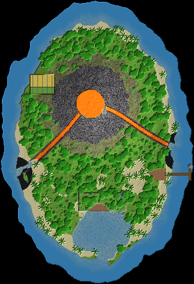

# 06 – Die Vulkaninsel

**Feuer, Wasser und Dschungel auf einer eigenen Insel im Meer.**

Mitten im Meer liegt eine Insel von rund 260 × 380 Blöcken. In ihrem Norden ragt ein Vulkan 136 Blöcke hoch auf, mit Lavasee im Krater und zwei Lavaströmen, die bis zum schwarzen Strand fließen.

An den Hängen wächst Dschungel. Im Süden liegt eine türkise Lagune mit Sandriff, Palmen und einem Wasserfall. An der Ostküste gibt es einen Hafen mit Leuchtfeuer und Markt.

Die Base nutzt die Insel: Wohnen in der Klippe an der Lagune, Schmiede mit Blick in die Magmakammer, Lager in einer Lavaröhre, Farmen in einer Dschungel-Lichtung.

## Eckdaten

| | |
|---|---|
| Größe (B × L × H) | 323 × 473 × 160 Blöcke |
| Sichtbare Blöcke | 346.753 (≈ 200 Shulker-Kisten) |
| Einfügehöhe | Unterkante der Schematic auf **Y 23** |
| Hinweis | Dann liegt der Meeresspiegel auf Y 63, und der Kraterrand reicht bis Y 176. |

## Orte in der Landschaft

Positionen sind Koordinaten innerhalb der Schematic (X, Y, Z ab der unteren Ecke).

| Nr. | Ort | Art | Position | Beschreibung |
|---|---|---|---|---|
| 1 | Hafen | Eingang | 316 / 42 / 290 | Ein 35 Blöcke langer Steg mit Querplattform. Ein Leuchtfeuer aus Steinziegeln und Leuchtstein zeigt Booten nachts den Weg. |
| 2 | Strand-Markt | Shop | 264 / 45 / 290 | Ein Marktplatz aus Tropenholz direkt am Hafen, mit acht Ständen unter Palmen. |
| 3 | Wohnhöhle an der Lagune | Wohnen (im Fels) | 170 / 44 / 329 | Zwei Stockwerke in der Klippe am Nordufer der Lagune mit einer 40 Blöcke breiten Glasfront und einer Holzterrasse auf Pfählen über dem Wasser. |
| 4 | Lagune mit Wasserfall | Highlight | 170 / 41 / 388 | Eine flache, türkise Lagune hinter einem Sandriff, nur im Süden offen. Von der Klippe fällt ein Wasserfall hinein. |
| 5 | Schmiede mit Lavafenster | Werkstatt (im Fels) | 184 / 87 / 174 | Eine Halle in der Vulkanflanke. Durch eine Glaswand blickt man in die glühende Magmakammer. Ein Gang führt hinaus auf den Osthang. |
| 6 | Lager in der Lavaröhre | Lager (im Fels) | 80 / 55 / 202 | Eine alte Lavaröhre aus glattem Basalt, rund 60 Blöcke lang, mit Fässern an beiden Seiten. Pilzlichter hängen in der Decke. |
| 7 | Dschungel-Farm | Farm | 70 / 70 / 140 | Eine versteckte Lichtung mitten im Dschungel mit Weizenfeldern und Weiden für Tiere. |
| 8 | Krater mit Lavasee | Highlight | 150 / 153 / 172 | Der Krater ist 48 Blöcke breit, darin brodelt ein Lavasee. Zwei Lavaströme fließen in Basaltrinnen bis zum schwarzen Strand. |
| 9 | Aussicht am Kraterrand | Highlight | 173 / 146 / 185 | Der höchste Punkt der Insel, eine Plattform mit Seelenlaternen direkt am Kraterrand. |

## Bau-Reihenfolge

1. **Insel aufschütten**: Die Küstenlinie mit Sand abstecken und die Insel bis knapp über den Meeresspiegel aufschütten.
2. **Vulkan**: Den Kegel in Ringen hochziehen, unten Stein, oben Basalt und Schwarzstein. Krater aussparen, Magmakammer innen hohl lassen.
3. **Lava**: Lava zuletzt einfüllen, nachdem die Rinnen aus Basalt und Obsidian fertig sind. Bäume mindestens 6 Blöcke entfernt halten, sonst brennt der Dschungel.
4. **Lagune und Küste**: Lagune ausheben, Riff aus Sand, Strände, schwarzer Strand aus schwarzem Trockenbeton.
5. **Base**: Wohnhöhle, Schmiede, Lavaröhre, Farm-Lichtung, Hafen mit Markt und Leuchtfeuer.
6. **Dschungel**: Tropenbäume, Palmen und Büsche. Zuletzt die Aussicht am Kraterrand.

## Tipps

- Lava entzündet Holz und Laub in der Nähe. Lavaströme deshalb mit Stein einfassen und Abstand zum Dschungel halten. Feuerausbreitung lässt sich nur per Serverregel abschalten.
- Schwarzer Trockenbeton sieht aus wie Vulkansand. Er darf nicht nass werden, sonst wird er zu Beton.
- Die Schematic so einfügen, dass der Meeresspiegel auf Y 63 liegt (Unterkante auf Y 23).

## Materialliste (sichtbare Blöcke)

Gezählt sind nur Blöcke, die man sieht. Das Innere von Bergen und Inseln kann aus beliebigem Material sein.

| Block | Anzahl | Stacks | Shulker |
|---|---:|---:|---:|
| Tropenbaumlaub | 63.472 | 992 | 36.7 |
| Stein | 62.570 | 978 | 36.2 |
| Sand | 48.488 | 758 | 28.1 |
| Andesit | 44.412 | 694 | 25.7 |
| Grasblock | 36.264 | 567 | 21.0 |
| Schwarzstein | 20.128 | 315 | 11.6 |
| Tropenbaumstamm | 15.450 | 242 | 8.9 |
| Kies | 9.510 | 149 | 5.5 |
| Basalt | 7.636 | 120 | 4.4 |
| Tuffstein | 7.276 | 114 | 4.2 |
| Ton | 4.079 | 64 | 2.4 |
| Lava | 4.046 | 64 | 2.3 |
| Glatter Basalt | 3.692 | 58 | 2.1 |
| Azaleenlaub | 3.300 | 52 | 1.9 |
| Grobe Erde | 2.909 | 46 | 1.7 |
| Granit | 2.676 | 42 | 1.5 |
| Tropenholzbretter | 2.352 | 37 | 1.4 |
| Erde | 2.206 | 35 | 1.3 |
| Schwarzer Trockenbeton (schwarzer Sand) | 1.480 | 24 | 0.9 |
| Ackerboden | 720 | 12 | 0.4 |
| Weizen | 720 | 12 | 0.4 |
| Fichtenholzbretter | 687 | 11 | 0.4 |
| Glas | 567 | 9 | 0.3 |
| Polierter Andesit | 523 | 9 | 0.3 |
| Magmablock | 512 | 8 | 0.3 |
| Obsidian | 260 | 5 | 0.2 |
| Steinziegel | 206 | 4 | 0.1 |
| Fichtenholzzaun | 169 | 3 | 0.1 |
| Bemooste Steinziegel | 168 | 3 | 0.1 |
| Fichtenstamm | 125 | 2 | 0.1 |
| Fass | 61 | 1 | 0.0 |
| Laterne | 39 | 1 | 0.0 |
| Leuchtstein | 36 | 1 | 0.0 |
| Pilzlicht | 5 | 1 | 0.0 |
| Seelenlaterne | 4 | 1 | 0.0 |
| Schmelzofen | 2 | 1 | 0.0 |
| Werkbank | 1 | 1 | 0.0 |
| Schmiedetisch | 1 | 1 | 0.0 |
| Amboss | 1 | 1 | 0.0 |

## Dateien

- `vulkaninsel.litematic`: für die Mod **Litematica**. Die Landschaft erscheint als Geisterblöcke in der Welt, und du baust sie Block für Block nach.
- `vulkaninsel.schem`: für **WorldEdit**. Mit `//paste -a` einfügen, damit Luft nichts überschreibt.
- `draufsicht.png`: Draufsicht als Bild.

Die 3D-Ansicht mit allen Orten gibt es im Viewer (`../../viewer/index.html`).
