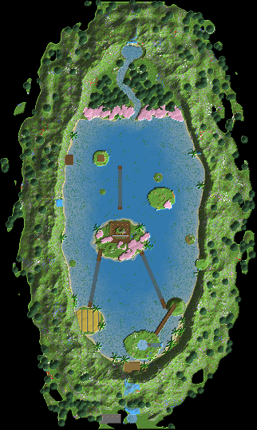

# 07 – Das Türkis-Tal

**Ein verstecktes Tal mit türkisem See, Inseln darin und Inseln darüber.**

Kombination aus verstecktem Tal, türkisem See und schwebenden Inseln. Von außen sieht man nur Berge. Durch einen Tunnel hinter dem Wasserfall kommt man hinein.

Drinnen füllt ein türkiser See fast das ganze Tal. Im Wasser liegen eine große Wohninsel, eine Farminsel, ein Felsturm mit dem Lager und kleine Palmeninseln. Darüber schweben vier Inseln, von einer stürzt ein Wasserfall in den See.

Hängebrücken, Stege und ein gläserner Blasen-Aufzug verbinden alles. Im Norden liegen eine Kirschwiese und ein Fichtenwald, von den Wänden fallen Wasserfälle.

## Eckdaten

| | |
|---|---|
| Größe (B × L × H) | 322 × 539 × 162 Blöcke |
| Sichtbare Blöcke | 508.338 (≈ 294 Shulker-Kisten) |
| Einfügehöhe | Unterkante der Schematic auf **Y 5** |
| Hinweis | Dann liegt der Boden rund um die Berge auf Y 63 und der Seespiegel auf Y 58. |

## Orte in der Landschaft

Positionen sind Koordinaten innerhalb der Schematic (X, Y, Z ab der unteren Ecke).

| Nr. | Ort | Art | Position | Beschreibung |
|---|---|---|---|---|
| 1 | Geheimer Eingang | Eingang | 165 / 61 / 518 | Hinter einem 72 Blöcke hohen Wasserfall an der Außenwand beginnt ein 47 Blöcke langer Tunnel. Am Ende öffnet sich der Blick auf den türkisen See. |
| 2 | Shop-Platz | Shop | 138 / 58 / 524 | Ein Marktplatz vor dem Wasserfall. Besucher handeln hier draußen und sehen den See nicht. |
| 3 | Türkiser See | Highlight | 185 / 54 / 340 | Der See füllt fast das ganze Tal, rund 160 × 300 Blöcke. Durch den hellen Grund aus weißem Sand und Calcit leuchtet er türkis. Am Rand ist er nur 2–4 Blöcke tief, in der Mitte bis 12. |
| 4 | Wohninsel | Wohnen (im Fels) | 150 / 59 / 287 | Die größte Insel im See. Im Hügel liegt eine gewölbte Wohnhöhle mit Glasfront zum See und einer Terrasse. Davor führt ein Steg aufs Wasser. |
| 5 | Lager im Felsturm | Lager (im Fels) | 220 / 56 / 384 | Ein 36 Blöcke hoher Felsturm im See. Unten liegt eine runde Lagerhalle mit Fässern rundum, eine Wendeltreppe führt nach oben. |
| 6 | Farminsel | Farm | 108 / 57 / 402 | Eine flache Insel voller Weizenfelder mit Wasserrinnen. Eine Hängebrücke führt zur Wohninsel. |
| 7 | Farmhöhle | Farm (im Fels) | 250 / 57 / 160 | Eine 16 Blöcke hohe Halle in der Ostwand für Eisen- oder Mobfarm. |
| 8 | Werkstatt am Ufer | Werkstatt (im Fels) | 70 / 57 / 200 | Eine Höhle in der Westwand direkt am Wasser, mit Holzsteg davor. |
| 9 | Verzauberungsinsel | Werkstatt | 202 / 127 / 248 | Sie schwebt 72 Blöcke über dem See. Ein gläserner Blasen-Aufzug fährt von der Wohninsel hinauf. |
| 10 | Wasserfallinsel | Highlight | 178 / 111 / 432 | Eine schwebende Insel mit eigenem kleinen See. Sein Abfluss stürzt über die Kante in den großen See. Eine lange Hängebrücke kommt vom Felsturm herauf. |
| 11 | Aussichtsinsel | Highlight | 126 / 153 / 198 | Die höchste schwebende Insel, fast 100 Blöcke über dem Wasser. |

## Bau-Reihenfolge

1. **Abstecken**: Talumriss, Seeufer, Inseln und Tunnel mit Wolle markieren.
2. **Berge**: Den Bergring hochziehen: innen steil, außen flacher, oben Schnee.
3. **See ausheben**: Den See flach ausheben (am Rand 2–4 tief, Mitte bis 12) und den Grund mit weißem Sand und Calcit auslegen. Das macht das Wasser türkis.
4. **Inseln**: Wohninsel mit Hügel, Farminsel, Felsturm und Palmeninseln aufschütten. Dann die schwebenden Inseln mit Gerüst bauen.
5. **Wasser**: See füllen, Wasserfälle setzen, Blasen-Aufzug bauen.
6. **Base und Natur**: Räume, Brücken, Stege, Bäume, Wege mit Laternen.

## Tipps

- Richtig türkis wird Wasser in Minecraft nur in warmen Biomen. Am stärksten im warmen Ozean, hellblau im Kirschhain. Ein heller Grund (Sand, Calcit) hilft überall.
- Flaches Wasser über hellem Sand sieht viel türkiser aus als tiefes. Deshalb ist der See am Rand nur 2–4 Blöcke tief.
- Den Tunnel erst zum Schluss öffnen, damit das Tal bis zur Enthüllung geheim bleibt.

## Materialliste (sichtbare Blöcke)

Gezählt sind nur Blöcke, die man sieht. Das Innere von Bergen und Inseln kann aus beliebigem Material sein.

| Block | Anzahl | Stacks | Shulker |
|---|---:|---:|---:|
| Stein | 180.443 | 2.820 | 104.4 |
| Andesit | 78.085 | 1.221 | 45.2 |
| Grasblock | 46.646 | 729 | 27.0 |
| Fichtennadeln | 44.494 | 696 | 25.7 |
| Tuffstein | 37.546 | 587 | 21.7 |
| Moosblock | 31.993 | 500 | 18.5 |
| Sand | 26.271 | 411 | 15.2 |
| Erde | 13.934 | 218 | 8.1 |
| Calcit | 10.497 | 165 | 6.1 |
| Ton | 8.454 | 133 | 4.9 |
| Bemooster Bruchstein | 7.314 | 115 | 4.2 |
| Kirschblätter | 3.962 | 62 | 2.3 |
| Bruchstein | 3.154 | 50 | 1.8 |
| Fichtenholzbretter | 2.435 | 39 | 1.4 |
| Grobe Erde | 1.806 | 29 | 1.0 |
| Steinziegel | 1.708 | 27 | 1.0 |
| Azaleenlaub | 1.699 | 27 | 1.0 |
| Fichtenstamm | 1.100 | 18 | 0.6 |
| Tropenbaumlaub | 904 | 15 | 0.5 |
| Blühendes Azaleenlaub | 880 | 14 | 0.5 |
| Granit | 661 | 11 | 0.4 |
| Ackerboden | 642 | 11 | 0.4 |
| Weizen | 642 | 11 | 0.4 |
| Kirschstamm | 534 | 9 | 0.3 |
| Trampelpfad | 468 | 8 | 0.3 |
| Glas | 446 | 7 | 0.3 |
| Fichtenholzzaun | 276 | 5 | 0.2 |
| Birkenlaub | 274 | 5 | 0.2 |
| Tropenbaumstamm | 272 | 5 | 0.2 |
| Hängende Wurzeln | 189 | 3 | 0.1 |
| Bemooste Steinziegel | 159 | 3 | 0.1 |
| Mangrovenwurzeln | 147 | 3 | 0.1 |
| Bücherregal | 106 | 2 | 0.1 |
| Laterne | 77 | 2 | 0.0 |
| Birkenstamm | 55 | 1 | 0.0 |
| Fass | 36 | 1 | 0.0 |
| Schwarzeichenstamm | 11 | 1 | 0.0 |
| Entrindeter Fichtenstamm | 11 | 1 | 0.0 |
| Schmelzofen | 2 | 1 | 0.0 |
| Schneeblock | 1 | 1 | 0.0 |
| Werkbank | 1 | 1 | 0.0 |
| Schmiedetisch | 1 | 1 | 0.0 |
| Amboss | 1 | 1 | 0.0 |
| Seelensand | 1 | 1 | 0.0 |

## Dateien

- `tuerkis-tal.litematic`: für die Mod **Litematica**. Die Landschaft erscheint als Geisterblöcke in der Welt, und du baust sie Block für Block nach.
- `tuerkis-tal.schem`: für **WorldEdit**. Mit `//paste -a` einfügen, damit Luft nichts überschreibt.
- `draufsicht.png`: Draufsicht als Bild.

Die 3D-Ansicht mit allen Orten gibt es im Viewer (`../../viewer/index.html`).
