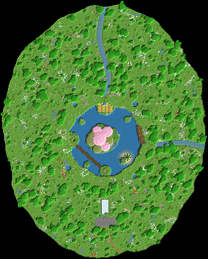

# 08 – Das Himmelsloch

**Ein Riesenloch im Dschungel mit schwebenden Inseln über einem türkisen See.**

Kombination aus Riesen-Doline, schwebenden Inseln und türkisem See. Oben öffnet sich im Dschungel ein 120 Blöcke breites Loch, darunter weitet es sich zu einer Glocke von 180 Blöcken.

In der Glocke schweben vier Inseln über einem flachen, türkisen See. Auf der größten wächst ein Kirschbaum dem Licht entgegen, von ihr läuft ein Wasserfall in den See.

Ein Spiralweg führt an der Wand hinunter. Hängebrücken gehen von ihm zu den Inseln: Lager, Farm, Verzauberung und die Hauptinsel mit dem Wohnraum.

## Eckdaten

| | |
|---|---|
| Größe (B × L × H) | 339 × 423 × 145 Blöcke |
| Sichtbare Blöcke | 483.274 (≈ 279 Shulker-Kisten) |
| Einfügehöhe | Unterkante der Schematic auf **Y -47** |
| Hinweis | Dann liegt der Dschungel auf Y 63 und der türkise See auf Y -17. |

## Orte in der Landschaft

Positionen sind Koordinaten innerhalb der Schematic (X, Y, Z ab der unteren Ecke).

| Nr. | Ort | Art | Position | Beschreibung |
|---|---|---|---|---|
| 1 | Einstieg zum Spiralweg | Eingang | 224 / 111 / 205 | Am Rand beginnt der Holzweg an der Wand. Von ihm zweigen Hängebrücken zu den schwebenden Inseln ab, unten endet er am türkisen See. |
| 2 | Glasplattform und Shop | Shop | 171 / 112 / 362 | Eine Glasplattform ragt 22 Blöcke über den Abgrund. Dahinter liegt der Marktplatz für Besucher. |
| 3 | Hauptinsel mit Kirschbaum | Highlight | 161 / 89 / 226 | Die größte Insel schwebt mitten im Loch, 38 Blöcke über dem See. Ein Kirschbaum wächst zur Öffnung hinauf, Wurzeln hängen nach unten, ein Teich läuft als Wasserfall in den See. |
| 4 | Wohnraum in der Hauptinsel | Wohnen (im Fels) | 163 / 60 / 226 | Ein Raum im Inselkörper unter dem Kirschbaum, mit Glasfenstern zur Seite. Eine Leiter führt nach oben auf die Insel. |
| 5 | Lagerinsel | Lager (im Fels) | 113 / 67 / 228 | Eine hohle Insel an der Westseite mit Fassregalen. Eine Brücke kommt vom Spiralweg, eine zweite führt zur Hauptinsel. |
| 6 | Farminsel | Farm | 171 / 65 / 172 | Weizenfelder auf einer schwebenden Insel an der Nordseite, verbunden mit Wand und Hauptinsel. |
| 7 | Verzauberungsinsel | Werkstatt | 171 / 95 / 279 | Eine kleine Insel mit Bücherregal-Ring an der Südseite, direkt unter der Glasplattform. |
| 8 | Werkstatt in der Wand | Werkstatt (im Fels) | 144 / 90 / 315 | Eine Kammer am oberen Teil des Spiralwegs. |
| 9 | Farmhöhle | Farm (im Fels) | 251 / 43 / 291 | Eine 13 Blöcke hohe Halle kurz über dem See, für Eisen- oder Mobfarmen. |
| 10 | Türkiser See | Highlight | 205 / 32 / 258 | Ein flacher See mit weißem Sand- und Calcitgrund, eine Sandinsel mit Palmen. Hier landen alle Wasserfälle. |
| 11 | Unterwasser-Raum | Wohnen (im Fels) | 150 / 20 / 316 | Am Ende des Spiralwegs geht es hinunter in einen Raum mit Glaswand zum türkisen See. |

## Bau-Reihenfolge

1. **Loch ausheben**: Oben 120 Blöcke Durchmesser, darunter breiter (Glocke). Den Boden flach lassen, er wird zum See.
2. **See**: Grund mit weißem Sand und Calcit auslegen, 2–14 Blöcke tief füllen. Eine Sandinsel mit Palmen aufschütten.
3. **Spiralweg**: Den Weg an der Wand von oben nach unten bauen. Er dient als Gerüst für alles Weitere.
4. **Schwebende Inseln**: Vom Spiralweg aus Brücken ins Leere bauen und daran die Inseln aufhängen: erst die Oberseite, dann die Unterseite nach unten.
5. **Base**: Wohnraum, Lager, Farm, Verzauberung, Werkstatt, Unterwasser-Raum.
6. **Leben**: Kirschbaum, Lianen, Wasserfälle, Glasplattform und Dschungel oben.

## Tipps

- Türkis wird das Wasser am stärksten in warmen Biomen (warmer Ozean). Ein heller, flacher Grund hilft überall.
- In der Glocke ist es schattig. Laternen an Ketten unter den Inseln und Seelaternen im See machen es nachts magisch.
- Beim Bau der Inseln über dem Abgrund: Gerüst nutzen und Feder-Fall-Stiefel anziehen.

## Materialliste (sichtbare Blöcke)

Gezählt sind nur Blöcke, die man sieht. Das Innere von Bergen und Inseln kann aus beliebigem Material sein.

| Block | Anzahl | Stacks | Shulker |
|---|---:|---:|---:|
| Grasblock | 91.073 | 1.424 | 52.7 |
| Andesit | 86.704 | 1.355 | 50.2 |
| Stein | 83.553 | 1.306 | 48.4 |
| Tropenbaumlaub | 56.764 | 887 | 32.8 |
| Diorit | 28.637 | 448 | 16.6 |
| Moosblock | 20.360 | 319 | 11.8 |
| Tuffstein | 16.932 | 265 | 9.8 |
| Calcit | 16.228 | 254 | 9.4 |
| Tropenbaumstamm | 14.291 | 224 | 8.3 |
| Sand | 14.008 | 219 | 8.1 |
| Bemooster Bruchstein | 8.951 | 140 | 5.2 |
| Erde | 7.643 | 120 | 4.4 |
| Azaleenlaub | 6.759 | 106 | 3.9 |
| Fichtenholzbretter | 6.141 | 96 | 3.6 |
| Bruchstein | 4.462 | 70 | 2.6 |
| Ton | 3.197 | 50 | 1.9 |
| Kirschblätter | 2.944 | 46 | 1.7 |
| Tropfsteinblock | 2.785 | 44 | 1.6 |
| Blühendes Azaleenlaub | 2.430 | 38 | 1.4 |
| Kies | 1.799 | 29 | 1.0 |
| Steinziegel | 1.588 | 25 | 0.9 |
| Fichtenholzzaun | 1.062 | 17 | 0.6 |
| Podsol | 756 | 12 | 0.4 |
| Kirschstamm | 680 | 11 | 0.4 |
| Höhlenranken mit Leuchtbeeren | 552 | 9 | 0.3 |
| Glas | 520 | 9 | 0.3 |
| Granit | 517 | 9 | 0.3 |
| Hängende Wurzeln | 366 | 6 | 0.2 |
| Dunkler Prismarin | 321 | 6 | 0.2 |
| Ackerboden | 264 | 5 | 0.2 |
| Weizen | 262 | 5 | 0.2 |
| Fass | 240 | 4 | 0.1 |
| Mangrovenwurzeln | 226 | 4 | 0.1 |
| Trampelpfad | 137 | 3 | 0.1 |
| Laterne | 76 | 2 | 0.0 |
| Bücherregal | 34 | 1 | 0.0 |
| Entrindeter Fichtenstamm | 10 | 1 | 0.0 |
| Seelaterne | 2 | 1 | 0.0 |

## Dateien

- `himmelsloch.litematic`: für die Mod **Litematica**. Die Landschaft erscheint als Geisterblöcke in der Welt, und du baust sie Block für Block nach.
- `himmelsloch.schem`: für **WorldEdit**. Mit `//paste -a` einfügen, damit Luft nichts überschreibt.
- `draufsicht.png`: Draufsicht als Bild.

Die 3D-Ansicht mit allen Orten gibt es im Viewer (`../../viewer/index.html`).
