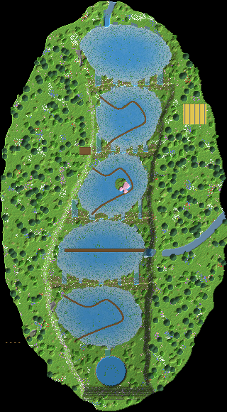

# 09 – Das Kaskaden-Tal

**Fünf türkise Seen in Stufen, zwanzig Wasserfälle und ganz unten ein Riesenloch.**

Kombination aus Tal, türkisen Seen und Doline. In eine bewaldete Hochebene ist eine 550 Blöcke lange Schlucht geschnitten. Darin liegen fünf türkise Seen hintereinander, jeder etwa 10 Blöcke tiefer als der vorige.

Über moosige Sinterdämme stürzen zwanzig Kaskaden von See zu See. Von der Hochebene fällt ein großer Wasserfall in den vierten See. Am Südende verschwindet alles in einem runden Doline-Loch.

Holzstege führen im Zickzack über die Seen. Der Wohnbereich liegt hinter dem großen Wasserfall, das Lager im Damm hinter einer Kaskade.

## Eckdaten

| | |
|---|---|
| Größe (B × L × H) | 320 × 580 × 139 Blöcke |
| Sichtbare Blöcke | 524.000 (≈ 303 Shulker-Kisten) |
| Einfügehöhe | Unterkante der Schematic auf **Y -49** |
| Hinweis | Dann liegt die Hochebene auf Y 63, und die Seen liegen darunter in der Schlucht. |

## Orte in der Landschaft

Positionen sind Koordinaten innerhalb der Schematic (X, Y, Z ab der unteren Ecke).

| Nr. | Ort | Art | Position | Beschreibung |
|---|---|---|---|---|
| 1 | Treppentunnel (Eingang) | Eingang | 45 / 113 / 470 | Auf der Hochebene führt ein Treppentunnel mit Laternen 56 Blöcke hinab und kommt am untersten See aus der Felswand. |
| 2 | Shop auf der Hochebene | Shop | 19 / 0 / 488 | Ein Marktplatz im Wald direkt neben dem Tunneleingang. |
| 3 | Fünf türkise Seen | Highlight | 180 / 91 / 165 | Fünf Seen liegen in Stufen hintereinander, von Y 100 bis Y 56 (Schematic). Heller Sand- und Calcitgrund macht sie türkis. Über die Dämme stürzen zwanzig Kaskaden. |
| 4 | Wohnbereich hinter dem großen Wasserfall | Wohnen (im Fels) | 240 / 72 / 355 | Ein Fluss von der Hochebene stürzt 44 Blöcke tief in den vierten See. Direkt dahinter liegt der Wohnbereich mit zwei Stockwerken. Durch die Glaswand sieht man den Wasservorhang. |
| 5 | Lager im Sinterdamm | Lager (im Fels) | 173 / 81 / 202 | Eine lange Halle im Damm zwischen zweitem und drittem See, hinter einer Kaskade. Fassregale auf 44 Blöcken Länge. |
| 6 | Werkstatt am ersten See | Werkstatt (im Fels) | 107 / 103 / 81 | Eine Höhle in der Westwand, direkt neben dem Nordfall. |
| 7 | Verzauberungsinsel | Werkstatt | 170 / 84 / 259 | Eine kleine Insel im mittleren See mit Bücherregal-Ring und Kirschbaum. Der Holzsteg führt daran vorbei. |
| 8 | Holzstege | Highlight | 162 / 81 / 247 | Zickzack-Stege aus Fichtenholz führen knapp über dem Wasser quer über drei Seen, wie in den Plitvicer Seen. |
| 9 | Felder auf der Hochebene | Farm | 274 / 113 / 160 | Eine Lichtung im Wald östlich der Schlucht mit Weizenfeldern und Wasserrinnen. |
| 10 | Farmhöhle | Farm (im Fels) | 62 / 59 / 440 | Eine 15 Blöcke hohe Halle in der Westwand am untersten See für Eisen- oder Mobfarmen. |
| 11 | Doline am Südende | Highlight | 156 / 30 / 522 | Der unterste See läuft in ein rundes Loch und stürzt 27 Blöcke tief in einen türkisen Teich. Lianen hängen am Rand. |
| 12 | Aussicht am Westrand | Highlight | 121 / 113 / 212 | Eine Holzplattform ragt über die Schlucht. Von hier sieht man alle Kaskaden. |

## Bau-Reihenfolge

1. **Schlucht ausheben**: Die Schlucht Stufe für Stufe von Norden nach Süden ausheben. Jede Stufe etwa 10 Blöcke tiefer.
2. **Seen und Dämme**: Seen flach ausheben, Grund mit weißem Sand und Calcit auslegen. Die Dämme dazwischen aus Moos, Calcit und Tropfstein bauen.
3. **Wasser**: Seen von oben nach unten füllen. In jeden Damm 4–5 Rinnen schneiden, aus denen Wasser als Kaskade nach unten fällt.
4. **Großer Wasserfall**: Den Fluss auf der Hochebene bauen und über die Kante fallen lassen. Dahinter den Wohnbereich mit Glaswand aushöhlen.
5. **Doline**: Am Südende das runde Loch graben, Teich unten füllen.
6. **Base und Natur**: Lager im Damm, Werkstatt, Farmen, Stege, Treppentunnel, Shop, Wald.

## Tipps

- Wasser fließt in Minecraft nur 7 Blöcke weit. Für breite Kaskaden in jede Rinne mehrere Quellblöcke setzen.
- Türkis wird das Wasser in warmen Biomen am stärksten. Der helle Grund aus Sand und Calcit hilft überall.
- Die Seen sind am Rand nur 2–4 Blöcke tief. Flaches Wasser über hellem Grund leuchtet am schönsten.

## Materialliste (sichtbare Blöcke)

Gezählt sind nur Blöcke, die man sieht. Das Innere von Bergen und Inseln kann aus beliebigem Material sein.

| Block | Anzahl | Stacks | Shulker |
|---|---:|---:|---:|
| Stein | 130.603 | 2.041 | 75.6 |
| Calcit | 89.443 | 1.398 | 51.8 |
| Grasblock | 83.779 | 1.310 | 48.5 |
| Fichtennadeln | 33.512 | 524 | 19.4 |
| Andesit | 28.359 | 444 | 16.4 |
| Moosblock | 25.532 | 399 | 14.8 |
| Sand | 21.848 | 342 | 12.6 |
| Diorit | 20.995 | 329 | 12.1 |
| Tuffstein | 20.096 | 314 | 11.6 |
| Eichenlaub | 11.208 | 176 | 6.5 |
| Tropfsteinblock | 7.576 | 119 | 4.4 |
| Birkenlaub | 7.548 | 118 | 4.4 |
| Ton | 7.503 | 118 | 4.3 |
| Erde | 6.731 | 106 | 3.9 |
| Bemooster Bruchstein | 6.130 | 96 | 3.5 |
| Azaleenlaub | 3.973 | 63 | 2.3 |
| Fichtenholzbretter | 3.511 | 55 | 2.0 |
| Bruchstein | 2.850 | 45 | 1.6 |
| Eichenstamm | 2.074 | 33 | 1.2 |
| Blühendes Azaleenlaub | 2.056 | 33 | 1.2 |
| Birkenstamm | 1.545 | 25 | 0.9 |
| Steinziegel | 1.438 | 23 | 0.8 |
| Kies | 1.370 | 22 | 0.8 |
| Fichtenstamm | 1.041 | 17 | 0.6 |
| Ackerboden | 812 | 13 | 0.5 |
| Weizen | 812 | 13 | 0.5 |
| Tropenbaumlaub | 427 | 7 | 0.2 |
| Fass | 307 | 5 | 0.2 |
| Fichtenholzzaun | 271 | 5 | 0.2 |
| Kirschblätter | 229 | 4 | 0.1 |
| Bücherregal | 138 | 3 | 0.1 |
| Glas | 135 | 3 | 0.1 |
| Laterne | 55 | 1 | 0.0 |
| Bemooste Steinziegel | 49 | 1 | 0.0 |
| Kirschstamm | 29 | 1 | 0.0 |
| Trampelpfad | 11 | 1 | 0.0 |
| Werkbank | 1 | 1 | 0.0 |
| Schmiedetisch | 1 | 1 | 0.0 |
| Schmelzofen | 1 | 1 | 0.0 |
| Amboss | 1 | 1 | 0.0 |

## Dateien

- `kaskaden-tal.litematic`: für die Mod **Litematica**. Die Landschaft erscheint als Geisterblöcke in der Welt, und du baust sie Block für Block nach.
- `kaskaden-tal.schem`: für **WorldEdit**. Mit `//paste -a` einfügen, damit Luft nichts überschreibt.
- `draufsicht.png`: Draufsicht als Bild.

Die 3D-Ansicht mit allen Orten gibt es im Viewer (`../../viewer/index.html`).
